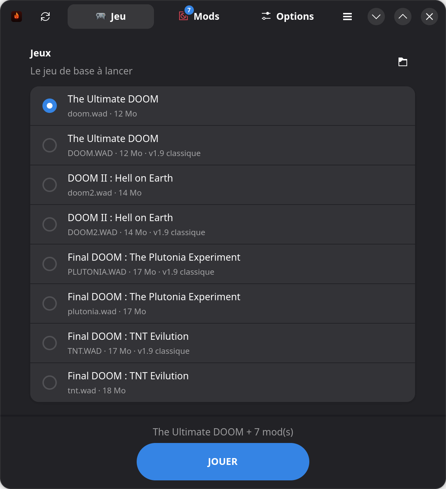
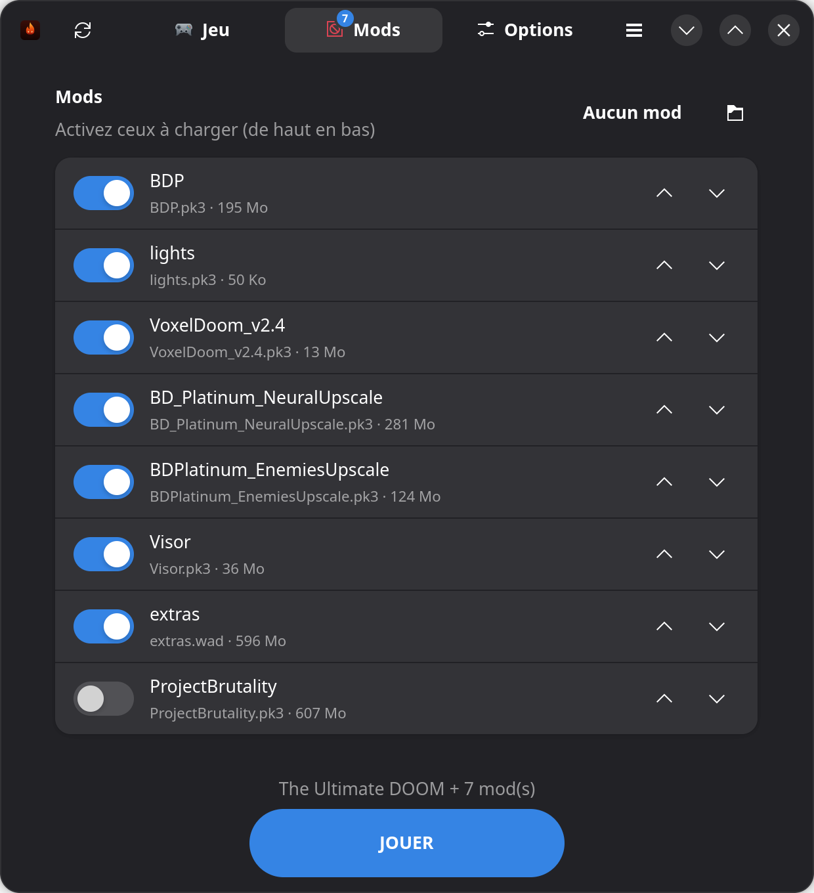
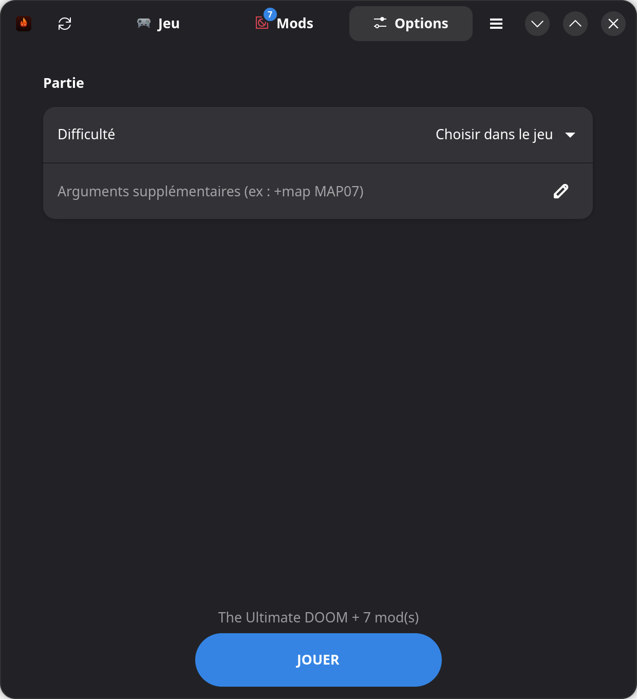

# DOOM Launcher

Petit lanceur graphique (GTK4 / libadwaita) pour [UZDoom](https://github.com/UZDoom/UZDoom) sous Linux, pensé pour Bazzite.

<p align="center">
  
  
  
</p>

- **Télécharge / met à jour UZDoom** depuis les releases GitHub officielles
- **Trois onglets** : *Jeu*, *Mods* et *Options* ; le bouton **JOUER** reste toujours visible
- **Choix de l'épisode** : Ultimate DOOM, DOOM II, TNT, Plutonia, Freedoom, Heretic, Hexen…
  Les extensions (SIGIL, SIGIL II, Master Levels, ou tout autre PWAD avec des cartes) sont lancées automatiquement avec le bon IWAD
- **Mods optionnels** (`.pk3`, `.wad`, `.zip`, `.deh`…) : interrupteur par mod, ordre de chargement réglable, bouton « Aucun mod », nombre de mods actifs affiché sur l'onglet
- Difficulté, arguments supplémentaires, mémorisation des choix, journal en cas de plantage
- **Se met à jour tout seul** : un bandeau prévient quand une nouvelle version de DOOM Launcher est publiée

## Installation

Télécharger `DOOM_Launcher-x86_64.AppImage` dans les [Releases](../../releases), puis :

```bash
chmod +x DOOM_Launcher-x86_64.AppImage
./DOOM_Launcher-x86_64.AppImage
```

Ou l'ouvrir avec **Gear Lever** pour l'ajouter au menu.

**Dépendances** (déjà présentes sur Bazzite / Fedora Atomic) : `python3`, `python3-gobject`, `gtk4`, `libadwaita`.

## Mises à jour

- **DOOM Launcher** vérifie à chaque démarrage s'il existe une nouvelle version dans les [Releases](../../releases). Si oui, un bandeau propose **Mettre à jour** : l'AppImage est remplacé sur place, puis l'application propose de redémarrer.
- **UZDoom** est vérifié de la même façon (bandeau séparé).
- Vérification manuelle : ☰ → **Vérifier les mises à jour**.
- Les gestionnaires d'AppImage (**Gear Lever**, AppImageUpdate) peuvent aussi le mettre à jour : les informations de mise à jour (zsync) sont intégrées à l'AppImage.

## Dossiers

Réglables dans ☰ → **Paramètres** :

| Quoi | Par défaut |
|---|---|
| WAD (jeux) | `~/.local/share/games/uzdoom` |
| Mods | `~/Games/UZDoom` |
| UZDoom | `~/Applications/UZDoom.AppImage` |

Au premier lancement, si un `UZDoom.sh` existe dans le dossier des mods, les `-file` qu'il contient sont repris comme mods activés.

Configuration : `~/.config/doom-launcher/config.json` · Journal : `~/.cache/doom-launcher/uzdoom.log`

> Les fichiers WAD commerciaux (DOOM, DOOM II…) ne sont pas fournis : utilisez vos propres copies (Steam, GOG…) ou [Freedoom](https://freedoom.github.io/).

## Construire l'AppImage

```bash
./build.sh
```

Le code est dans `AppDir/usr/share/doom-launcher/launcher.py`.

### Publier une nouvelle version

1. Augmenter `APP_VERSION` dans `launcher.py`
2. `./build.sh` (produit l'AppImage et son `.zsync`)
3. `gh release create vX.Y.Z DOOM_Launcher-x86_64.AppImage DOOM_Launcher-x86_64.AppImage.zsync`

Les utilisateurs verront la mise à jour au prochain lancement.

## Licence

MIT
